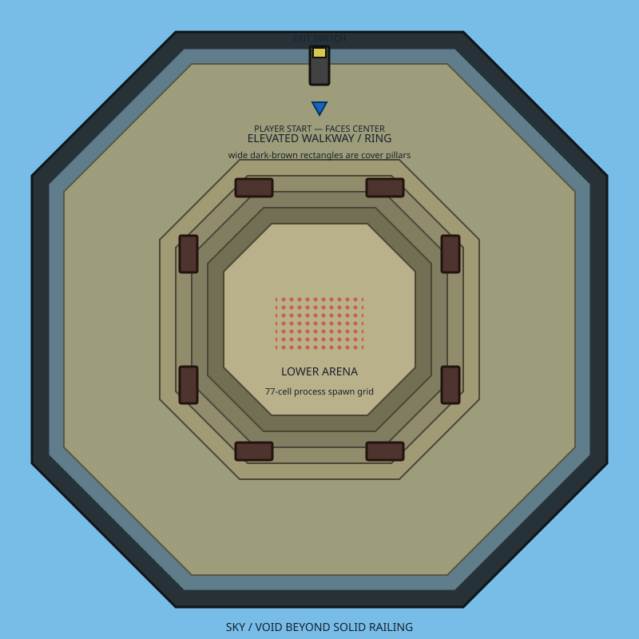

# psDoom

psDoom is a macOS Doom app that turns running processes into labeled monsters.
Play a short, one-time arena to see what is running on your Mac, then continue
into the regular Doom campaign.

> **Before you play:** psDoom can affect real processes, always through its
> bundled [Summoner](docs/summoner.md). Out of the box nothing is changed:
> Summoner's built-in `ps` plugin runs dry, so every hit is only logged. If you
> allow it to act (see [Process controls](#process-controls-and-safety)),
> wounding lowers a process's scheduling priority, and in live mode defeating
> a monster sends `SIGTERM` to it without an in-game confirmation or undo.
> Save your work first.

## What it does

During psDoom's process arena, each selected process becomes a monster with its
name shown above it. By default, tougher monsters represent processes using more
memory; you can instead size them by recent CPU load.



The octagonal sky arena is a one-time process-management level, not a
replacement campaign map. psDoom starts by playing the game's own demo. Choose
**New Game** to enter the process arena (`PSDINTRO`); leave it through its exit
to continue with the unmodified campaign from `E1M1` onward.

## What you need

- macOS 11 or later.
- CMake 3.16 or later.
- Python 3.10 or later.
- Homebrew libraries for the build:

  ```sh
  brew install sdl2 sdl2_mixer libsamplerate libpng fluid-synth
  ```

- An internet connection the first time you build, to download Freedoom.
- To play with process monsters: a `python3` psDoom can find without a shell
  (Homebrew's `/opt/homebrew/bin/python3`, or the Command Line Tools,
  `xcode-select --install`). Without one psDoom still runs, and says on screen
  that there are no process monsters.

You do not need any Doom game data. psDoom ships with
[Freedoom](https://freedoom.github.io/) Phase 1, a free game compatible with
Doom. If you own Doom, psDoom can use your copy instead (see
[Using your own Doom](#using-your-own-doom)).

## Install and launch

From the project folder, download Freedoom, then build and open the app:

```sh
tools/fetch-freedoom.sh
cmake -S . -B build
cmake --build build -j
open build/psDoom.app
```

`tools/fetch-freedoom.sh` downloads Freedoom 0.13.0 from its official GitHub
release, checks it against the SHA-256 pinned in `tools/freedoom.sha256`, and
puts `freedoom1.wad` with its licence and credits in the `wads/` folder. That
folder is not tracked by Git. The build checks the file again and copies it
into the app. If it is missing, the build stops and tells you to run the script.

## Using your own Doom

psDoom picks its game data when it starts:

1. If you start it with `-iwad <file>`, it uses that file.
2. Otherwise it uses a registered or Ultimate Doom `DOOM.WAD` if it finds one in
   `DOOMWADDIR`, then in each `DOOMWADPATH` folder, then in
   `~/Library/Application Support/psDoom`.
3. Otherwise it uses the bundled Freedoom.

The process arena runs on registered Doom, Ultimate Doom and Freedoom Phase 1.
psDoom never picks the shareware `DOOM1.WAD` or a Doom II IWAD by itself. If
you start it with `-iwad` on either of them, you get the plain game with no
process arena and no process monsters.

Saved games are kept per IWAD, so games saved while psDoom ran on another IWAD
(such as an older build's shareware `DOOM1.WAD`) do not appear under Freedoom.

## How to play

1. Launch psDoom and watch the game's demo. No process management runs
   during demos.
2. Choose **New Game** and complete Doom's normal episode and skill selection.
   psDoom opens its one-time process arena.
3. Fight the labeled monsters in the arena. Their labels show process names by
   default; process IDs are available as an option.
4. Use the exit when you are finished. The regular campaign resumes at
   `E1M1` and continues normally.

Normal Doom map, demo, save, and PWAD command-line controls bypass the bundled
intro arena so they retain their usual behavior.

## Process controls and safety

psDoom does not read or touch processes itself. It runs the copy of
[Summoner](docs/summoner.md) bundled in the app (`Contents/Resources/summoner`),
whose `ps` plugin lists your processes and acts on them. psDoom only tells
Summoner which monster was hit and how far it may go.

Open **Options** > **psDoom Options** to adjust how psDoom represents and acts
on processes. Settings are saved with Doom's configuration.

- **Effect via Summoner:** what a hit does to the real process. **Off** does
  nothing; **Wounds only**, the default, lets a wound lower the process's
  priority (renice) and a kill do nothing; **Wounds and kills** also lets
  defeating a monster quit the process (`SIGTERM`). The help line under the
  setting says what a wound and a kill do, in the plugin's own words. The
  built-in `ps` plugin follows this setting: there is nothing to configure.
  Every hit, acted on or not, is logged in
  `~/.config/summoner/state/ps/audit.jsonl`. (An optional
  `~/.config/summoner/plugins/ps.json` can only restrict it further, for
  example `{"dry_run": true}` or `{"plugin": {"allow_remove": false}}`; see
  [docs/summoner.md](docs/summoner.md).)
- **Exclusions:** the `ps` plugin leaves out session-critical processes,
  session plumbing (login, sudo, ssh, tmux, terminal apps, login shells),
  processes not fully yours, psDoom itself and the shell or launcher chain
  that started it. These safeguards reduce risk; they do not replace careful
  use of live-kill mode.
- **Arena readability:** psDoom displays up to 10 live process monsters by
  default. Adjust the cap from 5 to 35 in the options menu. The most relevant
  processes are shown first, in Summoner's order.
- **Sort by:** Summoner's `ps` plugin offers **Relevance** (the default),
  **Memory**, **CPU** and **Age**; psDoom asks for your choice on the next
  update, and a process's monster reflects its place in that order.
- **No process monsters?** psDoom says why once, on screen and in its log:
  Summoner missing from the app, no `python3`, or Summoner not answering. It
  never falls back to touching processes itself.
- **Fork bursts:** if a process suddenly creates many children, psDoom can add a
  capped cosmetic swarm around its monster. Those swarm enemies do not represent
  processes and never renice or terminate anything.

## More information

- [docs/spec/](docs/spec/README.md): the normative specs (script contract, Summoner,
  process access). Contributors and agents: see [AGENTS.md](AGENTS.md).

For advanced technical details, including the app architecture and build
internals, see [the architecture guide](docs/architecture.md). To make psDoom
represent custom entities such as containers or jobs, see [the script backend
guide](docs/script-backend.md).

Related projects and background:

- [Upstream psDooM](http://psdoom.sourceforge.net/)
- [psdoom-ng](https://github.com/orsonteodoro/psdoom-ng1), a Chocolate Doom
  lineage reimplementation
- Dennis Chao, _Doom as an Interface for Process Management_ (LISA 2000)
- [Internet Archive CDX API](https://web.archive.org/cdx/search/cdx), which
  helped preserve the original Mac OS X/X11 port

## License and credits

psDoom is released under the [MIT License](LICENSE). It continues the original
psDooM concept by Dennis Chao; the SourceForge psDooM project was maintained by
David Koppenhofer and based on XDoom by Udo Munk. This macOS revival builds on
[Crispy Doom](https://github.com/fabiangreffrath/crispy-doom), which is licensed
under GPL-2.0-or-later; its licence text ships inside the app as
`psDoom.app/Contents/Resources/Crispy-Doom-COPYING.md`. The app icon is the
Crispy Doom icon, contributed to Crispy Doom by Philip K., and is likewise
GPL-2.0-or-later, not covered by psDoom's MIT licence.

The bundled game data is [Freedoom](https://freedoom.github.io/) 0.13.0,
Copyright (c) 2001-2024 Contributors to the Freedoom project, used under the
BSD 3-Clause licence. Its full licence text and credits ship inside the app as
`psDoom.app/Contents/Resources/Freedoom-COPYING.txt`,
`Freedoom-CREDITS.txt` and `Freedoom-CREDITS-MUSIC.txt`. Freedoom is not
covered by psDoom's MIT licence. Doom is a trademark of id Software; psDoom
does not include any id Software game data.
