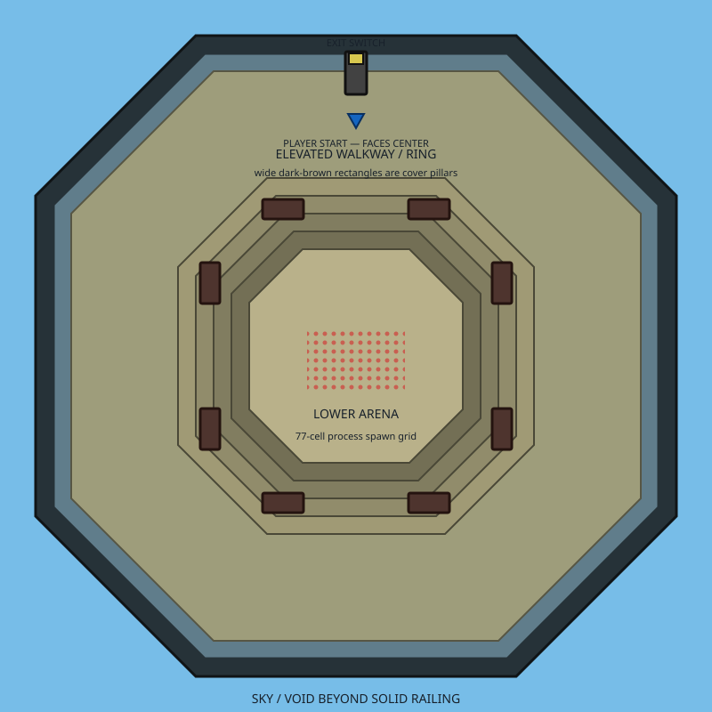

# psDoom

psDoom is a macOS Doom app that turns running processes into labeled monsters.
Play a short, one-time arena to see what is running on your Mac, then continue
into the regular Doom campaign.

> **Before you play:** psDoom can affect real processes. Its default setting only
> lowers a process's scheduling priority when you wound its monster, and does
> not terminate anything. Do not enable live killing unless you understand that
> defeating a monster can send `SIGTERM` to the matching process without an
> in-game confirmation or undo. Save your work first.

## What it does

During psDoom's process arena, each selected process becomes a monster with its
name shown above it. By default, tougher monsters represent processes using more
memory; you can instead size them by recent CPU load.



The octagonal sky arena is a one-time process-management level, not a
replacement campaign map. psDoom starts by playing the stock Doom demo. Choose
**New Game** to enter the process arena (`PSDINTRO`); leave it through its exit
to continue with the unmodified Doom campaign from `E1M1` onward.

## What you need

- macOS 11 or later.
- CMake 3.16 or later.
- Python 3.10 or later.
- A user-supplied Doom IWAD. psDoom does not include Doom game data.
- Homebrew libraries for the build:

  ```sh
  brew install sdl2 sdl2_mixer libsamplerate libpng fluid-synth
  ```

A shareware `DOOM1.WAD` is convenient for local use. Put your own copy at
`wads/DOOM1.WAD` before building, and the build will copy it into the app
bundle. This file is not included in psDoom or tracked by Git.

## Install and launch

From the project folder, build and open the app:

```sh
cmake -S . -B build
cmake --build build -j
open build/psDoom.app
```

If you do not use `wads/DOOM1.WAD`, put a compatible IWAD in
`~/Library/Application Support/psDoom`, or point `DOOMWADDIR` or `DOOMWADPATH`
to its location before launching. When neither environment variable is set, the
launcher searches the app bundle first and then
`~/Library/Application Support/psDoom`.

## How to play

1. Launch psDoom and watch the stock Doom demo. No process management runs
   during demos.
2. Choose **New Game** and complete Doom's normal episode and skill selection.
   psDoom opens its one-time process arena.
3. Fight the labeled monsters in the arena. Their labels show process names by
   default; process IDs are available as an option.
4. Use the exit when you are finished. The regular Doom campaign resumes at
   `E1M1` and continues normally.

Normal Doom map, demo, save, and PWAD command-line controls bypass the bundled
intro arena so they retain their usual behavior.

## Process controls and safety

Open **Options** > **psDoom Options** to adjust how psDoom represents and acts
on processes. Settings are saved with Doom's configuration.

- **Effect on real processes:** the default is **renice (no kill)**. Wounding a
  process monster lowers that process's scheduling priority; defeating it does
  not terminate it. **None (just a game)** makes no real changes. **Renice +
  KILL** is an explicit opt-in mode: wounding still lowers priority and
  defeating the monster sends `SIGTERM` to its process.
- **Targeting:** psDoom targets processes owned by the current user by default.
  You can enable all users' processes, but macOS permissions can prevent actions
  on processes you do not own.
- **Built-in exclusions:** session-critical processes, the psDoom app itself,
  and the shell or launcher chain that started it are not turned into monsters.
  These safeguards reduce risk; they do not replace careful use of live-kill
  mode.
- **Arena readability:** psDoom displays up to 10 live process monsters by
  default. Adjust the cap from 5 to 35 in the options menu. The most relevant
  processes are shown first.
- **Monster size:** choose **Memory** (the default) or **CPU load** to decide
  what makes a process monster tougher. psDoom updates a monster's size as its
  process changes.
- **Fork bursts:** if a process suddenly creates many children, psDoom can add a
  capped cosmetic swarm around its monster. Those swarm enemies do not represent
  processes and never renice or terminate anything.

## More information

For advanced technical details, including the app architecture and build
internals, see [the architecture guide](docs/architecture.md). To make psDoom
represent custom entities such as containers or jobs, see [the script backend
guide](docs/script-backend.md).

Related projects and background:

- [Upstream psDooM](http://psdoom.sourceforge.net/)
- [psdoom-ng](https://github.com/orsonteodoro/psdoom-ng1), a Chocolate Doom
  lineage reimplementation
- Dennis Chao, _Doom as an Interface for Process Management_ (LISA 2000)
- [Internet Archive CDX API](https://web.archive.org/cdx/search/cdx), which
  helped preserve the original Mac OS X/X11 port

## License and credits

psDoom is released under the [MIT License](LICENSE). It continues the original
psDooM concept by Dennis Chao; the SourceForge psDooM project was maintained by
David Koppenhofer and based on XDoom by Udo Munk. This macOS revival builds on
[Crispy Doom](https://github.com/fabiangreffrath/crispy-doom), which is licensed
under GPL-2.0-or-later.
